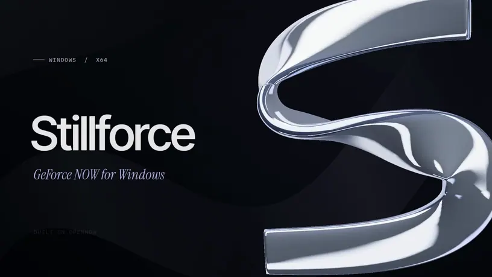
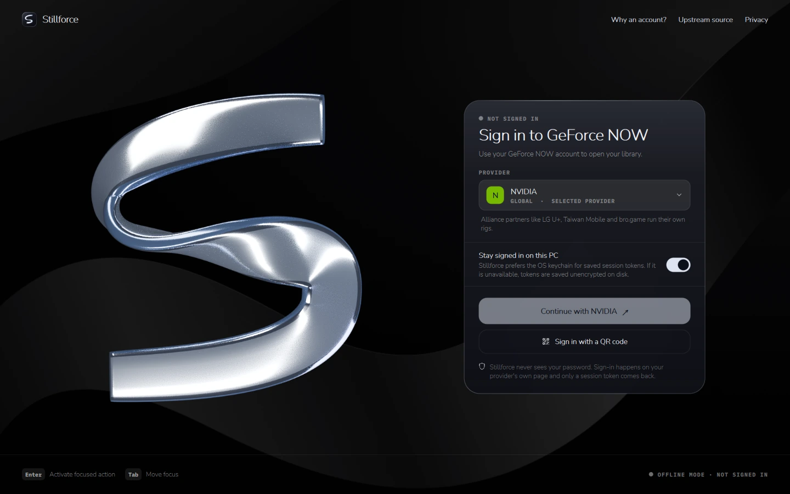
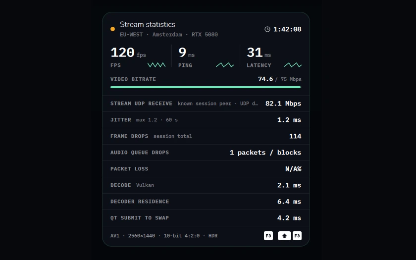

# Stillforce

A standalone **GeForce NOW client for Windows** with StillCord’s black satin, a sculpted silver sign-in screen and a floating glass menu. It runs on OpenNOW’s native Rust streaming engine. Bring your GeForce NOW account, choose an accent and open your library.

<a href="https://cdn.jsdelivr.net/gh/ll2Rawll/StillForce@motion-cut-home/docs/media/stillforce-trailer.mp4"><picture><source media="(prefers-reduced-motion: reduce)" srcset="docs/media/trailer-poster.webp"></picture></a>

**[Watch the 21-second trailer](https://cdn.jsdelivr.net/gh/ll2Rawll/StillForce@motion-cut-home/docs/media/stillforce-trailer.mp4)** · **[Download for Windows x64](https://github.com/ll2Rawll/StillForce/releases/download/stillforce-v1.0.5/Stillforce-Windows-x64.zip)** · [Save the MP4](https://github.com/ll2Rawll/StillForce/releases/download/stillforce-v1.0.5/Stillforce-Trailer.mp4) · [Get the source ZIP](https://github.com/ll2Rawll/StillForce/releases/download/stillforce-v1.0.5/Stillforce-Source.zip)

## Inside Stillforce

| Sign in | Make it yours | Inspect a session |
| :--- | :--- | :--- |
| [](docs/media/sign-in.webp) | [](docs/media/appearance.webp) | [](docs/media/statistics.webp) |
| Sign in through NVIDIA or an alliance provider. Search for games or open favorites and collections from your library. | Choose a theme, accent and background in **Settings → Appearance**. Use reduced motion for quieter menus, or switch to the controller layout. | Press **F3** for ping, packet loss, frame statistics and the rig your server reports. **Ctrl+G** opens the stream menu. The image shows sample data. |

## Run on Windows

1. Download the **Windows x64 ZIP** and extract the whole archive into a folder of your choice. [Windows download](https://github.com/ll2Rawll/StillForce/releases/download/stillforce-v1.0.5/Stillforce-Windows-x64.zip)
2. Open `Stillforce\bin\Stillforce.exe`. Keep the extracted folders together so Qt can find its plugins. If Windows asks for the Microsoft Visual C++ runtime, use the included `bin\vc_redist.x64.exe`.
3. Sign in, open your library and launch a game. Stillforce stores its settings in `%APPDATA%\Stillforce` and saves captures in `Pictures\Stillforce`.

This portable Windows build is unsigned. The packaged client passed sign-in screen, menu navigation and reduced-motion checks under Wine. A live, signed-in game session still needs verification on Windows hardware. To update, close the client and extract the next release into a fresh folder. Automatic usage and error reports are off by default. If you opt in, reports go to the OpenNOW developers. [Release notes](https://github.com/ll2Rawll/StillForce/releases/tag/stillforce-v1.0.5)

### Which rig did I get?

During a stream, press **F3** and look at the model beside the server location. NVIDIA chooses the rig. On Ultimate, RTX 5080 availability depends on the game, the server and capacity. NVIDIA says a full nearby server can assign an RTX 4080 before sending you to another region. Stillforce displays the assignment when NVIDIA reports it. [NVIDIA’s rig allocation guide](https://nvidia.custhelp.com/app/answers/detail/a_id/5702) · [GeForce NOW server status](https://status.geforcenow.com/)

### Packet loss and stutters

Open **F3** during a hitch and compare packet loss, ping and frame drops. If loss rises on Wi-Fi, try the same game and server over Ethernet. If the network readings stay steady, compare decode time and frame drops at a lower stream resolution. Testing one change at a time makes the results easier to interpret.

## Build from source

The Rust core handles sign-in, settings, the catalog and session requests. The native Rust streamer handles video, audio and input. The Windows interface uses Qt Quick and C++.

Use a Visual Studio 2022 x64 developer shell with CMake, Rust (MSVC), SDL3 and Qt 6.8 or newer. Install the Qt Quick, Multimedia, Shader Tools and SVG modules. Make Qt and SDL3 discoverable through `CMAKE_PREFIX_PATH`.

```powershell
cmake -S opennow-qt -B build/qt -G "Visual Studio 17 2022" -A x64
cmake --build build/qt --config Release --target opennow-qt
cmake --install build/qt --config Release --prefix dist/Stillforce
```

Open `dist\Stillforce\bin\Stillforce.exe`. Build all targets before running the complete native test suite. [Qt build guide](opennow-qt/README.md) · [Acceptance checks](docs/qt-acceptance.md)

## Credits

Stillforce is based on OpenNOW `v1.0.5` at commit `a9de957`. The Windows package combines the rebuilt Stillforce shell and account core with the matching upstream stream runtime and its dependencies. OpenNOW’s client and streaming implementation are MIT-licensed. [OpenNOW source at this revision](https://github.com/OpenCloudGaming/OpenNOW/tree/a9de957a5902c54186e9d4b44b1562f0b6beb951) · [Upstream README](README.upstream.md) · [MIT license](LICENSE) · [Third-party notices](THIRD_PARTY_NOTICES)

The black satin artwork comes from StillCord. The silver mark and ribbon were created for Stillforce. GeForce NOW and NVIDIA are trademarks of NVIDIA Corporation. [StillCord](https://github.com/ll2Rawll/StillCord) · [Artwork license](opennow-qt/res/brand/StillCord-LICENSE.txt)
